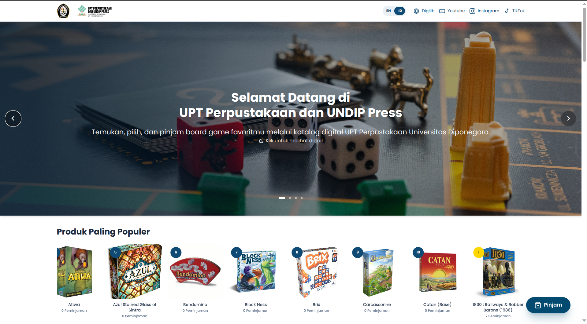
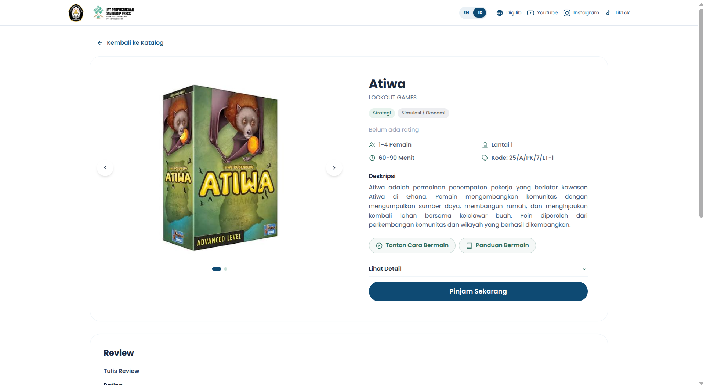

# Board Game Lending System

A web-based catalog and lending workflow for the board game collection at **UPT Perpustakaan Universitas Diponegoro**.

| Project | Details |
| --- | --- |
| Type | Collaborative internship project |
| Domain | Library board game catalog and lending |
| Timeline | July–August 2026 |
| Institution | UPT Perpustakaan Universitas Diponegoro |
| Stack | React, Laravel |
| Repository | Portfolio case study with application source |

## Overview

Board Game Lending System is a web application built to make the library's board game collection easier to discover and borrow. Visitors can browse a digital catalog, view detailed game information, check availability, and submit a borrowing request online. Library staff use an administrative area to manage the collection, review requests, process returns, and monitor lending activity.

The application was developed collaboratively by a team during an internship at UPT Perpustakaan Universitas Diponegoro, using React for the frontend and Laravel for the backend.

This repository contains the application source for portfolio review, shared with permission from the project owner. Environment files, credentials, database data, and uploaded media are not included.

## Problem Statement

The existing board game service had several practical challenges:

- Visitors had to check the physical shelves to find out which games were available.
- The borrowing process still depended heavily on manual staff involvement.
- Collection information and lending records needed a more structured way to be managed and reviewed.

These issues made it harder for visitors to discover the collection and for staff to keep the lending process consistent.

## Solution

The system provides a centralized digital experience for both visitors and library staff:

- A visitor-facing catalog that presents the board game collection with key information and availability status.
- Detail pages that help visitors evaluate a game before borrowing it.
- An online borrowing request flow that captures the required borrower and schedule information.
- A staff dashboard for managing games, approving or rejecting requests, processing returns, and reviewing lending history.
- Review and rating features that add visitor feedback to the catalog.

The application supports the digital side of the process. Physical handover, identity verification, and in-library use still follow the library's operational procedures.

## Screenshots

### Catalog



*Visitor-facing catalog with featured titles, availability indicators, game metadata, and a borrowing shortcut.*

### Board Game Detail



*Detail view with game information, description, guide links, borrowing action, and a review section.*

## Key Features

### Visitor-facing catalog

- Browse board games with cover images, publisher, categories, player count, duration, floor, availability, rating, and borrowing count.
- Search by game name and filter by category, floor, and availability status.
- Sort the catalog by popularity, rating, or name.
- View a dedicated detail page with an image gallery, description, game metadata, component list, and external tutorial or guide links.
- Submit a borrowing request with borrower details, identity guarantee information, preferred schedule, and notes.
- Read ratings and reviews, filter reviews by rating, and submit a review.
- Switch the interface between Indonesian and English.

### Staff and administration

- Authenticated staff area with role-aware access for selected management actions.
- Manage board game records, including stock, categories, floor and box location, photos, components, descriptions, and guide links.
- Review incoming borrowing requests and approve or reject them.
- Validate stock availability and prevent duplicate active loans for the same borrower identity.
- Process returns with condition assessment, missing component records, fines, and lost-item status.
- Restore available stock when a returned game is accepted.
- Browse lending history with search, status, game, and date-range filters, and export the results to CSV.
- View borrowing statistics by period and export the report to CSV.
- Moderate reviews and manage catalog-supporting content such as the homepage carousel and lending rules.

## Technology Stack

| Layer | Technology |
| --- | --- |
| Frontend | React |
| Backend | Laravel (PHP) |
| Frontend–backend integration | Inertia.js |
| Styling and UI | Tailwind CSS, daisyUI |
| Animation | Framer Motion |
| Build tooling | Vite |
| Database (development) | SQLite |

Only technologies verified from the project are listed.

## Getting Started

### Prerequisites

- PHP 8.3 or later
- Composer
- Node.js and npm
- SQLite

### Local setup

```bash
composer install
cp .env.example .env
php artisan key:generate
php artisan storage:link
touch database/database.sqlite

# Set SEED_ADMIN_PASSWORD in .env before seeding to create the demo administrator.
php artisan migrate --seed

npm install
npm run build
php artisan serve
```

`AdminSeeder` skips account creation when `SEED_ADMIN_PASSWORD` is empty. When it is set, the demo administrator account uses `admin@example.test` with that password. The original database, uploaded media, and environment credentials are not included in this repository; the commands above create a fresh local database from the included migrations and seeders.

## My Contributions

As a member of the development team, I contributed across the frontend and backend of the application:

- Collaborated with team members to build the board game lending system using React and Laravel.
- Contributed to the implementation and refinement of application features across both the frontend and backend.
- Worked closely with the team to integrate components, resolve technical issues, and improve overall application functionality.

## Team Project Context

This was a collaborative internship project at UPT Perpustakaan Universitas Diponegoro from July to August 2026. I worked as a collaborator on a private repository owned by another party.

The application source is included with permission from the project owner for portfolio review. Ownership remains with the original owner. Environment files, credentials, the original database, uploaded media, and the original Git history are not included.

Screenshots and seed data are included for documentation and demonstration purposes. Institution names and logos, as well as board game titles, cover art, and descriptions, remain the property of their respective owners.

## Project Status

**Status:** Completed internship project (July–August 2026).

This repository contains the application source for portfolio review, along with documentation and screenshots. No public demo is linked. Ownership of the original application remains with the project owner, and this is not the official project repository.
